# AgenticBots Platform — Architecture

AgenticBots **operates** Bots for clients. The platform has two surfaces in
one Next.js app, on top of one isolated runtime per client:

- **Operator console** (`/ops`, served at `ops.agenticbots.dev`) — where the
  AgenticBots team runs every client, Bot, run, automation, integration,
  invoice and runtime.
- **Client portal** (`/portal`, served at `app.agenticbots.dev`) — results,
  activity, approvals, requests, integrations and reports. Nothing technical.

Decisions and their reasons: `docs/adr/0001-platform-decisions.md`.

## 1. Overall architecture

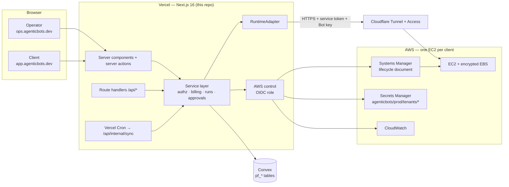

The browser only ever talks to AgenticBots. Runtime URLs, keys and AWS
identifiers stay on the server.

## 2. Operator console flow

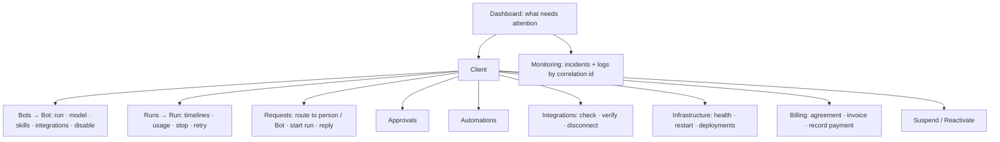

## 3. Client portal flow

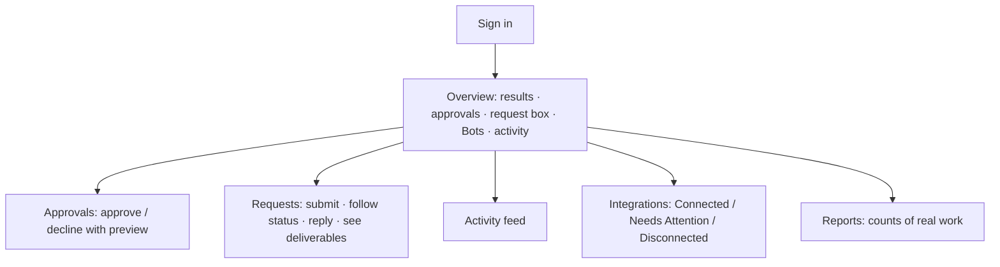

Every portal object is built by `src/server/views/client.ts` projections:
fields a client may not see are never copied, not filtered afterwards.

## 4. Tenant isolation

```mermaid
flowchart TB
  subgraph App["Shared app (authorization in code, every call)"]
    P[can(actor, permission, orgId)]
  end
  subgraph T1["Acme Roofing"]
    E1[EC2 + EBS + KMS key]
    S1[Secrets: agenticbots/prod/tenants/acme-…/*]
    R1[Instance role: reads ONLY acme-… secrets]
  end
  subgraph T2["Bob's Plumbing"]
    E2[EC2 + EBS + KMS key]
    S2[Secrets: agenticbots/prod/tenants/bobs-…/*]
    R2[Instance role: reads ONLY bobs-… secrets]
  end
  P --> T1
  P --> T2
```

- One EC2, one engine deployment, one KMS key and one IAM role per client.
  Unrelated clients never share an engine.
- In the database every tenant record carries `orgId` (indexed). The service
  layer loads a record, then proves `can(actor, …, record.orgId)`; a record
  from another tenant is reported as **not found** (URL-id probing reveals
  nothing). Tests: `tests/security/authz.test.ts`.

## 5. Bot → runtime profile mapping

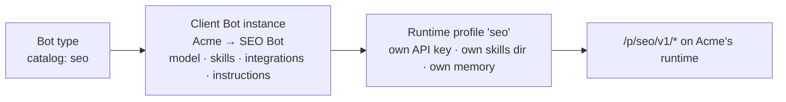

Bot types live in `src/config/bot-catalog.ts` (derived from the website's
catalog). Instances live in the `bots` table.

## 6. Bot Run lifecycle

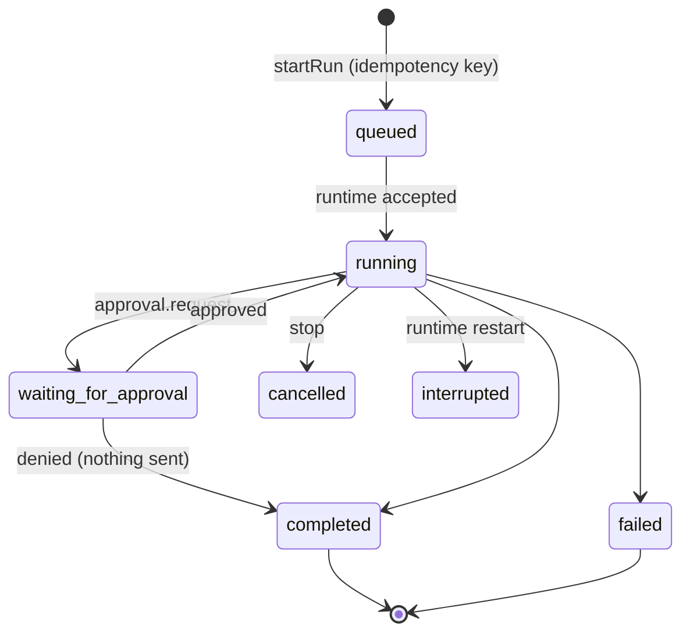

The browser starts a run and receives an AgenticBots run id; the work runs
on the client runtime regardless of the browser. Live updates come over a
reconnectable SSE stream (`/api/runs/:id/events`, 25s connections,
`Last-Event-ID` resume); `/api/internal/sync` reconciles every minute.

## 7. Request flow

```mermaid
sequenceDiagram
  participant C as Client
  participant P as Platform
  participant O as Operator
  participant B as Bot
  C->>P: Submit request (no Bot choice)
  P->>O: New request in queue
  O->>P: Assign operator / Bot, start Bot Run
  P->>B: Run
  B-->>P: Drafts ready → approval
  P->>C: Needs your approval
  C->>P: Approve
  P->>B: Execution run (idempotent on approval id)
  B-->>P: Result + METRICS
  P->>C: Activity + result; request Completed
```

## 8. Approval flow

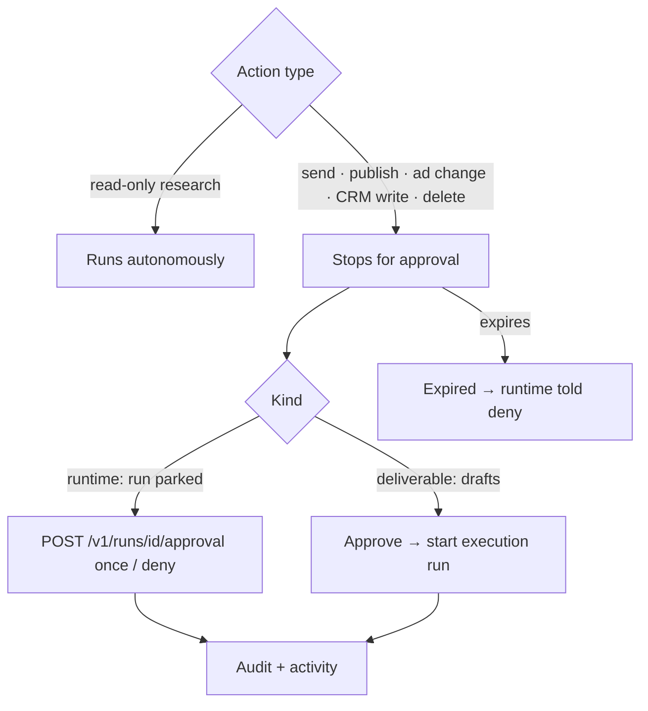

## 9. Manual billing flow

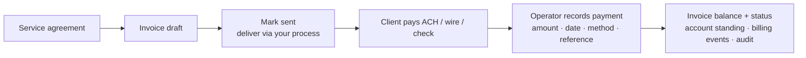

No card processor. `BillingProvider` is the seam for QuickBooks/Xero/Bill.com/
Stripe later; `ManualBillingProvider` is the default.

## 10. Billing suspension flow

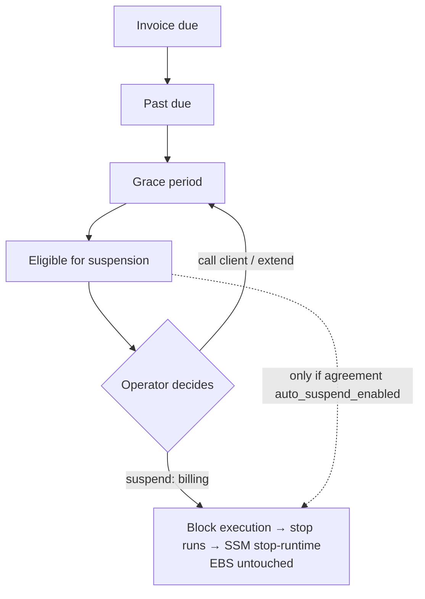

Default `auto_suspend_enabled = false`.

## 11. Payment → eligible for reactivation

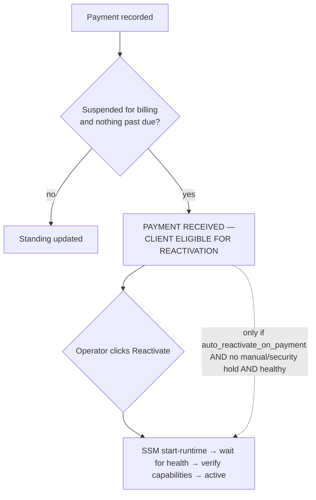

## 12. Secret flow

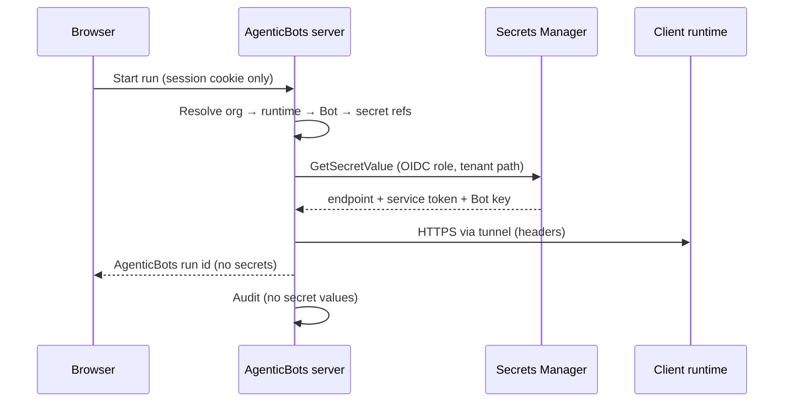

## 13. AWS runtime architecture

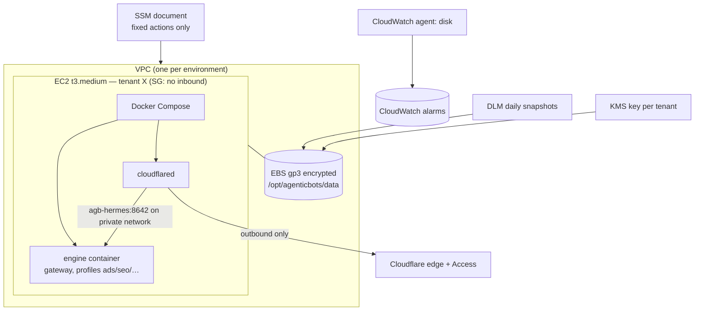

## Code map

| Concern | Where |
|---|---|
| Domain types | `src/lib/platform/types.ts` |
| Bot catalog / skills / integrations config | `src/config/*` |
| Storage (memory for demo/tests, Convex for prod) | `src/server/db/*`, `convex/platform.ts` |
| Auth, sessions, roles, permissions | `src/server/auth/*` |
| Runtime abstraction | `src/server/runtime/adapter.ts` |
| Engine-specific code (isolated) | `src/server/runtime/hermes/*` |
| Demo runtime | `src/server/runtime/demo/adapter.ts` |
| Event translation / error sanitization | `src/server/runtime/translate.ts`, `errors.ts` |
| Services | `src/server/services/*` |
| Billing domain + providers | `src/server/billing/*` (`providers/manual.ts`) |
| AWS control (OIDC) | `src/server/aws/control.ts` |
| Client projections | `src/server/views/*` |
| Operator console | `src/app/ops/*` |
| Client portal | `src/app/portal/*` |
| API | `src/app/api/*` |
| Terraform | `infra/terraform` |
| Runtime bundle (compose, lifecycle) | `infra/runtime` |
| Skills | `runtime/skills` |
| Provisioning CLI | `ops/cli.ts` |
