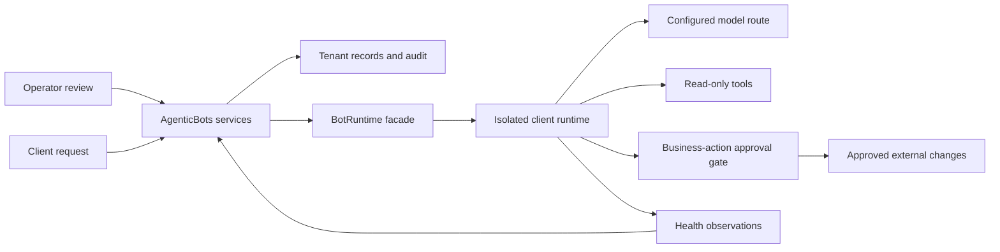

# Enterprise reliability and BOT operations

Decision record, 2026-10-09. Owner choices: standard isolated runtime, optional enterprise high availability; support diagnoses and prepares changes, the owner approves execution.

## Architecture direction

Keep the platform independent of both the agent harness and model provider. Hermes remains behind `BotRuntime` and `RuntimeAdapter`; views and workflows use neutral platform records. The current engine is pinned and tested with an in-process contract fixture. Updating upstream requires contract validation against that exact deployed version. Model routing stays configurable per BOT, with tenant-specific credentials, permissions and budgets.

Hermes supports an API server and multiple model connections; this is a useful foundation, not a unique guarantee of portability or uptime. Its API can execute tools on the server before returning a response, so external-action policy must be enforced at tool execution, not inferred from the wording of a final model answer. Source: [official API server documentation](https://hermes-agent.nousresearch.com/docs/user-guide/features/api-server). This repository's adapter contract and pinned version remain authoritative for supported features.

The diagram describes the existing logical boundary plus intended enforcement. It does not attest that every live integration has passed staging. Provider adapters still marked as stubs remain unavailable.

## Two deployment tiers

| Dimension | Standard isolated runtime | Optional enterprise HA target |
| --- | --- | --- |
| Runtime | One client on its own EC2/runtime and encrypted storage | Active/passive runtime in separate availability zones, isolated per client |
| State | Existing tenant storage and daily snapshot definitions | Validated replication/checkpoint path; no shared writable EBS across zones |
| Ownership | Single runtime scheduler | Fenced lease for one active scheduler and one execution owner; never let both copies send |
| Recovery | Documented restore/reprovision procedure, rehearsed in staging | Automated health-based failover after fencing, with idempotent recovery and tested failback |
| Model dependency | Configurable model/provider | Preapproved fallback route tested for the required tools, policy and data residency |
| Measurement | Continuous health checks, run outcomes and queue latency | Independent probes, availability/error budgets, dependency and failover evidence |
| Current status | Infrastructure code exists; no real deployment validated in this task | Design target; not provisioned or implemented as a functioning HA service |

A second server by itself is insufficient. The state, scheduler and outbound-action ownership must survive interruption without duplicate execution. Exact recovery time/point commitments depend on the tested state design and approved infrastructure budget.

## Reliability contract before an uptime promise

Start with a **99.9% availability objective over a rolling 30 days**, distinct from a contractual SLA. Define availability as the ability of an eligible client to submit an authorized BOT task and have it durably accepted, plus a separate workflow completion/freshness objective appropriate to that service. A human approval wait is an intentional state, not a failed task. Record provider failures and platform failures separately while still showing their effect on the client.

For a time-based SLI, 99.9% allows 43.2 minutes of bad time per 30 days. This arithmetic is a planning budget, not measured performance. Do not calculate uptime from “good samples / samples collected”: a missing probe or unavailable monitoring system must remain visible, and the denominator must include the defined observation window. Agree on maintenance and suspended-account treatment before any SLA.

The [Google SRE SLO workbook](https://sre.google/workbook/implementing-slos/) distinguishes an objective from its measurement, emphasizes user-visible outcomes and uses error budgets to prioritize reliability work. The design below applies those principles to this platform. [AWS's Reliability Pillar](https://docs.aws.amazon.com/wellarchitected/latest/reliability-pillar/welcome.html) provides the infrastructure review framework; successful restore and failure testing are release evidence, not dashboard styling.

## Release sequence and acceptance evidence

1. **One real staging tenant.** Deploy only after owner authorization, with approved cost ceiling. Use the existing first-staging runbook. Verify pinned engine capabilities, tenant credentials, tunnel authentication, health, manual run, scheduled run, event persistence and approval resume/deny. Record any unsupported endpoint behavior; do not invent compatibility.
2. **Durable execution control.** Add a transactional intent/outbox and worker claims with bounded leases, heartbeat, exponential backoff/jitter, retry limits and dead-letter inspection. Reconcile the platform and runtime after ambiguous timeouts. Reuse stable operation IDs; retries of sends or writes require provider idempotency or explicit reconciliation. Never automatically replay an ambiguous external write. Current UI/runtime configuration updates are not a distributed transaction.
3. **Telemetry and alert delivery.** Build on `runtime_health_samples` with independent authenticated probes, queue age, run latency, success by service, stale schedules, provider errors/rate limits, storage headroom, backup freshness and restore age. Use structured redacted logs/correlation IDs. Distinguish liveness, readiness and integration health. A monitoring watchdog must detect missing sync executions. Validate alert delivery and escalation to the owner; no alert subscription was created here.
4. **Support BOT trial.** Create a tenant-bound read-only diagnostic profile. It may read authorized evidence and prepare a proposal containing source dates, uncertainty, affected records, verification and rollback. Deny deployment, messaging, budget changes and destructive tools at the server boundary. Bind approval to the exact proposed action/record version with expiry. Mutating work runs separately after human approval; client replies remain drafts. Evaluate false diagnoses, cross-tenant requests and injected instructions before enabling paid inference.
5. **Model routing and cost controls.** Test an allowlisted fallback for safe reads after rate-limit/transient failures. Cap attempts, tokens and spend per tenant/run and fail closed. Do not fail over across disallowed data residency or retention boundaries. Do not retry an action that might already have taken effect. Compare tool behavior and output quality before making a model an automatic fallback.
6. **Recovery exercises.** Terminate a worker mid-run; stop the runtime; interrupt the tunnel; force provider throttling; fill a test volume; revoke a test integration; restore a snapshot into an isolated tenant. Prove no duplicate writes, no cross-client state and a reviewable recovery history. Add checkpoint/replay support where the pinned runtime permits it, or report an interrupted run rather than fabricate continuation.
7. **HA enterprise tier.** Implement only after standard-tier recovery evidence exists. Test zone loss, state convergence, fencing, approval expiry during failover and duplicate scheduler prevention. Record measured RTO/RPO and infrastructure costs before quoting the tier.
8. **Operational handoff.** Maintain owner-readable incident and rollback playbooks, a release canary, patch cadence and a tested restore schedule. Freeze risky releases when the agreed error budget is exhausted. A one-person operating model still needs an explicit escalation/coverage arrangement for incidents outside working hours.

## What this change proves

Local tests cover fresh/stale/failed health evidence, tenant-scoped draft access, optimistic draft/source version checks, secret rejection, the paused-automation gate, prompt size preservation, support preparation without a run, scoped costs and immutable table registration. The redesigned console exposes these controls.

It does not prove live uptime, provider failover, automated recovery, backup restoration or an autonomous support service. Those require the staged implementation and evidence above. No infrastructure has been provisioned and no paid inference has run during this work.
