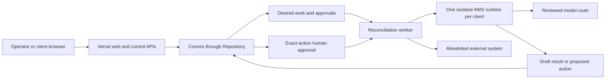

# AgenticBots launch implementation plan

_Updated 2026-10-12 from the Hermes documentation audit, security/legal
remediation status, deployment audit and reliability plan. This plan creates
reviewable local evidence before any cloud changes or paid model usage._

## Owner checklist

The next safe sequence is:

1. Complete the Hermes upgrade and least-privilege runtime configuration
   locally.
2. Run every local security, adapter and build gate.
3. Choose the staging domain, AWS account/budget ceiling and one production
   model provider.
4. Review the exact Terraform plan and monthly estimate.
5. Authorize one fake staging tenant only.
6. Prove backup, restore, schedules, approvals, duplicate prevention and
   failure handling.
7. Pilot one real client with read-only BOT work.
8. Enable one external write type only after its approval and idempotency test.

The website may launch independently while platform execution remains off.

## Launch architecture

Vercel serves the interface and short-lived control requests. Convex stores
the durable platform record. EC2 runs Hermes continuously. Terraform creates
repeatable infrastructure. Hermes and model providers remain replaceable
behind AgenticBots interfaces.

## Phase 0 — Public website launch

**Purpose:** make the marketing site available without presenting the runtime
platform as live.

Implementation:

- Keep course sales disabled.
- Keep live BOT execution, outbound messaging, billing automation and paid
  data vendors disabled.
- Verify production environment variables, security headers, privacy routes,
  cancellation/contact paths and consent behavior.
- Confirm that demo data is labeled and no internal runtime/provider name is
  present in client-facing bundles.
- Run the production build and deployment checks before promotion.

Exit evidence:

- Production URL, DNS and TLS work.
- Contact/proposal delivery is configured and tested with a controlled internal
  submission.
- Security/privacy release checklist is signed off.
- Rollback to the prior Vercel deployment is documented.

This phase requires a separate owner authorization to deploy or promote.

## Phase 1 — Runtime contract hardening (local only)

**Purpose:** turn the Hermes assumptions into enforceable configuration and
tests before AWS exists.

Progress on 2026-10-12:

- **Done locally:** explicit zero-tool API/cron allowlists, Bot Mode and
  self-scheduling disabled, 25-turn/600-second caps, bounded provider attempts,
  recovery cycling disabled and regression tests.
- **Done locally:** a read-only official-release watcher plus a durable
  `v0.21.7` candidate record containing tag, commit and manifest digest.
- **Blocked by missing Docker/staging:** real-image contract tests, SBOM scan,
  state migration/restore, network containment and canary soak. Candidate
  promotion stays false; neither the old pin nor the candidate is staging
  approved.
- **Still to implement:** model token/spend reservation, reviewed per-BOT tool
  overlays and egress lists, the drain/backup/upgrade lifecycle action and
  automated disposable-candidate qualification.

Implementation:

- Select a reviewed Hermes version at least as new as `v0.21.6`; pin its tag,
  commit and immutable image digest.
- Diff the selected source from `v2026.9.24`, including migrations, auth,
  profiles, API routes, jobs, sessions, state and configuration.
- Add an `upgrade-engine` lifecycle action with backup, digest verification,
  maintenance/drain, scheduler pause, health check and rollback support.
- Add a daily stable-release watcher that opens a candidate record with tag,
  commit, digest, release notes and scan evidence. It never deploys a tag by
  itself.
- Add a disposable-candidate test job and a sanitized state-migration test.
  Automatic rollback is enabled only when backward compatibility is proven.
- Explicitly allowlist API-server tools for the root and each BOT profile.
- Keep dashboard, plugins, Kanban dispatch, goals, heartbeats, messaging,
  webhooks, agent-created schedules, terminal and host code execution off.
- Keep Hermes Bot Mode protocol, canonical Bot Chats, group rooms and peers
  off. BOT-to-BOT work must enter through AgenticBots records and `BotRuntime`.
- Add finite caps for concurrency, turns, run duration, retries, tokens and
  provider spend where the selected version supports them. Add platform-side
  guards for anything Hermes cannot enforce.
- Deny contributor/training model routes for client data and match providers,
  fallbacks and credential pools by exact allowlisted ids.
- Add contract assertions for capabilities, effective toolsets, authentication,
  profile separation, stopped/approval states and secret redaction.
- Define the first model route and one optional fallback; use mocked responses
  in local tests.
- Document per-profile egress destinations. Keep browser/web/MCP disabled where
  an allowlist is not yet implemented.

Exit evidence:

- `npm run typecheck`, `npm run lint`, `npm test`, `npm run build` pass.
- Runtime boundary, tenant isolation, white-label and security tests pass.
- The fake Hermes contract matches the selected upstream version.
- No unexpected toolset is present.
- Upgrade and rollback can be exercised in a local disposable runtime.
- A broken candidate is rejected while the current runtime remains available.

## Phase 2 — Staging readiness package (no apply)

**Purpose:** make the first cloud change concrete and reviewable before asking
for authorization.

Implementation:

- Update the staging Terraform variables with placeholder-safe values and the
  selected engine digest.
- Produce a Terraform plan; save a redacted summary of created resources,
  permissions and estimated monthly cost.
- Verify separate staging Convex/Vercel/AWS/Cloudflare identities and prefixes.
- Set AWS budget alerts before runtime creation.
- Decide the runtime domain and model provider. Store no secret in Git.
- Review IAM with the least privileges required for staging and validate that
  lifecycle permissions are scoped to the staging environment.
- Add alert destinations and an incident contact.
- Complete the first-staging preflight checklist.

Exit evidence:

- Plan contains no destruction and no production resource.
- Cost ceiling and destroy procedure are recorded.
- Secrets inventory names owners and rotation/expiry without containing values.
- The owner reviews and explicitly authorizes the exact staging apply.

## Phase 3 — One fake AWS tenant

**Purpose:** prove the complete system with fictional data and one SEO BOT.

Implementation after explicit approval:

- Create the staging environment and one isolated runtime.
- Deploy one BOT profile with the approved tool allowlist and model route.
- Run authenticated health, capabilities and toolset checks.
- Execute a read-only BOT RUN with a stable idempotency key.
- Create, run, pause and resume one bounded schedule.
- Exercise approval deny, expiry and exact-action approval without contacting a
  real external account.
- Verify Convex reconciliation, append-only audit records and cross-tenant
  denial.
- Stop/restart the instance and confirm state recovery.

Exit evidence:

- Every result is captured with timestamps, version/digest, correlation IDs and
  redacted logs.
- No duplicate run or external write occurs under retries.
- Unexpected tool calls fail closed.
- Destroying staging follows the reviewed procedure and preserves required
  evidence.

## Phase 4 — Reliability and recovery

**Purpose:** collect evidence before making availability claims.

Implementation:

- Add durable execution intents, bounded worker leases, heartbeats, retry
  limits, exponential backoff and a dead-letter review path.
- Detect stale schedules, missing probes, queue age, run latency, provider
  errors, storage headroom, backup age and integration health.
- Rehearse model throttling, runtime termination, tunnel loss, interrupted
  runs, credential revocation and disk pressure.
- Restore a backup into an isolated staging runtime and verify the application
  record against runtime state.
- Route alerts by severity and send one quiet daily operating summary. Notify
  immediately only for client-impacting failures, approval needs or security
  events.

Exit evidence:

- Restore time and recovered data point are measured.
- Ambiguous external writes are reconciled rather than replayed.
- A missing monitor produces an alert.
- The operator can understand and recover each tested failure from the runbook.

## Phase 5 — First client pilot (read-only)

**Purpose:** validate usefulness with real data while preventing external
changes.

Implementation:

- Use one signed pilot agreement and one isolated tenant.
- Connect only the minimum read scopes required by the selected service.
- Complete privacy/security/vendor and data-retention review for those systems.
- Have BOTs diagnose, summarize and prepare changes for operator approval.
- Apply approved changes manually outside the BOT for the first pilot period.
- Review output quality, false positives, cost, latency and owner workload
  weekly.

Exit evidence:

- No cross-client disclosure, unapproved write or secret exposure.
- The client can inspect BOT ACTIVITY and understand what requires approval.
- Task-level quality and operating cost meet a recorded threshold.
- Offboarding and credential revocation are tested.

## Phase 6 — Approval-gated external action

**Purpose:** automate one narrow change safely.

Implementation:

- Select one reversible, low-risk action supported by a documented provider API.
- Build the adapter from current provider documentation with recorded-response
  tests.
- Bind approval to the exact payload, target, source version, actor and expiry.
- Enforce policy and `assertLive()` immediately before the external write.
- Use provider idempotency or post-write reconciliation. Never automatically
  retry an ambiguous action.
- Add audit entries for proposal, approval, attempt, provider response and
  verified outcome.

Exit evidence:

- Duplicate clicks and worker restarts cannot duplicate the action.
- A modified/expired proposal cannot execute.
- Revocation and rollback are demonstrated.
- The client sees a safe, provider-neutral activity record.

## Phase 7 — Scale and optional enterprise tier

**Purpose:** make repeatable client deployment and higher availability an
evidence-based product.

Implementation:

- Automate tenant creation from reviewed templates with per-client KMS,
  secrets, storage, runtime, budgets and monitoring.
- Add a canary upgrade ring, patch cadence and automatic contract reporting.
- Promote compatible stable Hermes releases through internal, client-canary,
  small-batch and fleet rings. Drain BOT RUNS, pause schedules, back up and
  reconcile before each container replacement. Stop the rollout automatically
  on regression.
- Measure capacity before changing instance size or concurrency.
- Add native Kanban only through a reviewed least-privilege interface; use a
  board as the client boundary and cap dispatch/retries/concurrency.
- Add a Chief-of-Staff BOT only after summaries are safe, tenant-scoped and
  sourced from Convex. It prepares a daily report and cannot execute changes.
- Design active/passive enterprise HA only after restore and scheduler fencing
  are proven. Record measured RTO/RPO and incremental cost.

Exit evidence:

- A new fake tenant is reproducibly created, verified and removed from one
  reviewed workflow.
- Canary rollback works.
- Enterprise commitments match measured availability and recovery evidence.

## Implementation backlog in order

1. Hermes version upgrade research and pinned digest.
2. Per-profile API tool allowlist and contract tests.
3. Finite run/model budgets and explicit launch-disabled features.
4. Egress policy for the first SEO BOT.
5. `upgrade-engine` lifecycle action and local rollback test.
6. Daily release watcher and disposable candidate qualification.
7. Staging plan/cost/IAM review package.
8. One authorized fake staging tenant and canary promotion proof.
9. Durable reconciliation and recovery exercises.
10. Read-only client pilot.
11. One approval-gated external integration.

Kanban, messaging, Chief-of-Staff meetings and enterprise HA remain deliberate
later phases. They do not block proving that the core service works.
