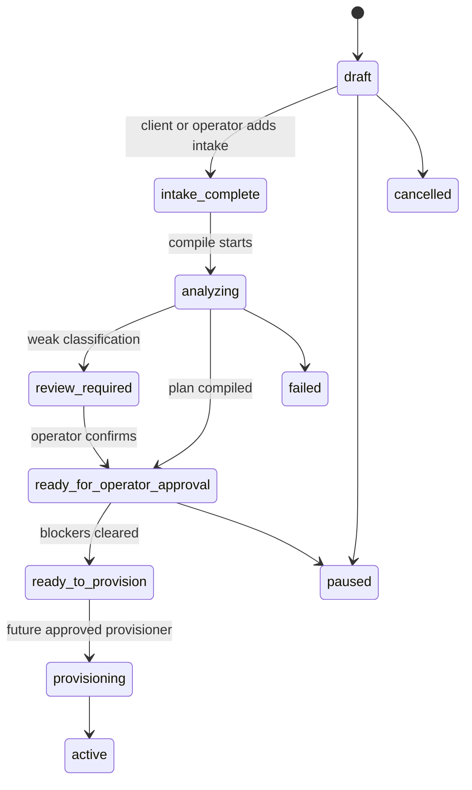

# Client onboarding architecture

Client onboarding turns a newly signed customer into a reviewed deployment
plan. It is a compiler, not a provisioning system: it reads the known client
intake, maps it through the existing AgenticBots catalogs and Prospect Graph,
creates draft private prospecting records where appropriate, and lists the
few human decisions that still matter.

It does not create AWS infrastructure, deploy a runtime, send email, connect
OAuth accounts, write to a CRM, call data vendors, or approve its own spend.

## Lifecycle

The stored record is `ClientOnboarding` in `client_onboardings`.

The current implementation compiles through `ready_for_operator_approval` or
`review_required`. `ready_to_provision` is only reached when the readiness
check has no blockers. The provisioning and active transitions are reserved
for a future approved provisioner.

## Stored model

The onboarding record tracks:

- `orgId`, `stage`, `readiness`, compiler version, timestamps and decisions.
- Intake: business name, website, services, service type, territories,
  opportunity size, target preferences, existing customers, exclusions and
  goals.
- Classification: service niche, category, sells-to profile, confidence,
  reasoning, vertical pack and prospectability/client-fit scores when already
  present in the ontology.
- Recommendations: Bot stack, ICP ids, buyer type ids, decision-maker role
  families, market ids, MarketBuild ids, integrations, skills, approval
  policies, budget plan and deployment plan.
- Exception checklists: only actions the client or operator must actually
  handle before provisioning.

Unknown stays unknown. The compiler stores no fabricated market totals,
TAM counts, provider prices, revenue numbers, review counts or external
signals.

## Compiler entry points

`src/server/services/onboarding.ts` exposes:

- `startClientOnboarding()` creates one active onboarding record per client.
- `updateOnboardingIntake()` lets an authorized client or operator add intake.
- `recordOnboardingDecision()` stores operator decisions such as confirmed
  niche, Bot stack override or approved budget.
- `compileOnboardingPlan()` reruns the deterministic compiler and updates
  the onboarding record.

Every entry point uses the platform `Repository`/`Tx` layer, checks
authorization with `can()`, and writes audit events for state-changing work.
Prospecting records are created only through Prospect Graph services.

## Business classification

Classification uses the seeded 341-niche ontology already loaded into
`pg_niches`. It compares the business name, website, organization industry,
description, services, target preferences, existing customer types and goals
against niche names, categories and tags.

The result includes confidence and plain-English reasoning. If the match is
weak or close to another niche, the onboarding moves to `review_required`
instead of forcing a niche. Operators can record a confirmed niche decision;
future compiles preserve that decision and mark classification as confirmed.

Vertical packs come from `src/server/prospecting/ontology/packs.ts` and are
selected from the confirmed or highest-confidence niche tags.

## ICP and buyer plan

For a confirmed niche, the compiler uses the existing niche-to-buyer graph:

- `defaultBuyerTypes()` selects strongest approved buyer relationships.
- Buyer types are filtered by service type, target preferences and exclusions.
- Approved relationships and vertical pack defaults produce decision-maker
  role families.
- `createIcp()` creates the actual private `pg_icps` record.

The compiler is idempotent. A rerun reuses the existing recommended ICP or a
matching client ICP instead of creating duplicates.

## MarketBuild plan

Each intake geography becomes a private `pg_markets` record through
`createMarket()`. Supported geography shapes include city, county, metro,
state and radius where `Geography` already supports it.

For each market the compiler creates or reuses a `pg_market_builds` draft. A
draft MarketBuild can contain the market definition, buyer types, discovery
recipes and maximum proposed data budget. Its coverage methodology explicitly
says market totals remain unknown until discovery runs.

No universe estimate or TAM count is invented.

## Bot stack recommendation

Bot recommendations come from the canonical Bot catalog in
`src/config/bot-catalog.ts`. The first-pass mapping is intentionally lean:

- Commercial contractor plans usually recommend SEO, Ads, Prospecting,
  Outbound, CRM and Analytics, with Content added for packs where it is an
  obvious support Bot.
- Residential-only local plans recommend SEO, Reviews, CRM and Analytics, and
  avoid the commercial Prospecting/Outbound plan by default.
- Reviews, Reactivation, Proposal and Content can remain optional when not
  core to the launch.

Operators can record a manual Bot stack decision. Reruns preserve the
operator-selected Bots and downgrade other default recommendations to optional
rather than silently re-enabling them.

## Skills and integrations

The skill plan expands each recommended Bot's default skills from
`src/config/skills.ts`. It records the intended skill version and flags missing
manifests as incompatible. It does not install skills.

Integration requirements are derived from the recommended Bots and the
existing integration registry. Requirements are tagged:

- `required` when the Bot cannot do the launch work without it, such as
  Google Ads for Ads Bot or an email connection for Outbound Bot.
- `recommended` when the integration improves the plan but should not block
  basic review.
- `optional` when it is a future enhancement.

Client-facing output uses friendly integration display names only. No OAuth
connection is attempted by onboarding.

## Approval policies

The approval plan starts from canonical Bot approval defaults:

- Read-only analytics, SEO research and recommendation generation are
  automatic.
- External sends, publishing, ad changes, CRM writes and budget increases
  require approval.
- Deleting data is prohibited by default.

Bots may not weaken the policy. Operators and clients may later choose
stronger restrictions.

## Budget planning

The data acquisition budget planner is deterministic and fail-closed.

If Prospecting Bot is not recommended, the budget is `not_needed`. If provider
pricing is not configured, the result is `budget_requires_configuration` and
no amount is stored. If prices are configured, the compiler can propose a
maximum budget from configured prices, market count and conservative
first-pass enrichment depth.

Any proposed amount remains `operator_approval_required` until an operator
records approval. The onboarding workflow cannot approve its own spend.

## Deployment plan

The deployment plan is read-only and draft-only. It describes what would be
created after approval:

- Runtime provider and region.
- Bot profiles, skill assignments and integration needs.
- Provider configuration status.
- MarketBuild records that future prospecting work would execute.

The compiler never calls the runtime provisioner or AWS control plane.

## Readiness

`ready_to_provision` requires:

- intake complete enough to classify the client,
- confirmed or high-confidence niche,
- Bot stack reviewed,
- required client integrations connected,
- spend approved or not needed,
- valid approval policies,
- model/provider configuration present,
- no blocking security issue.

Until those checks pass, readiness stays `ready_for_review` and the operator
sees the remaining blockers.

## Demo scenarios

Tests cover realistic fictional scenarios:

- Commercial Roofing in Columbus, Ohio.
- Commercial HVAC in Tampa, Florida.
- Asphalt/Paving in South Florida.
- Residential-only local roofing that should not receive the commercial
  prospecting/outbound stack.

All scenarios run with in-memory data and no external side effects.
